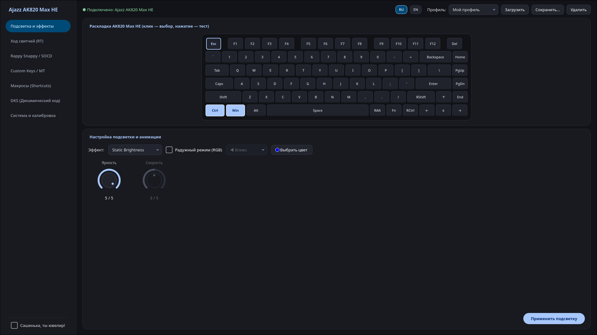

# Ajazz AK820 Max HE — Оффлайн-софт для настройки клавиатуры (Linux и Windows)

Простой и быстрый оффлайн-конфигуратор для магнитной клавиатуры **Ajazz AK820 Max HE** — работает локально на **Linux** и **Windows** без официального веб-драйвера и интернета.

Поддерживаются все функции клавиатуры: настройка RGB-подсветки, точка срабатывания и Rapid Trigger (вплоть до шага `0.01 мм`), Rappy Snappy, SOCD, переназначение клавиш (Normal / Fn / Mod-Tap / Toggle), макросы, DKS, частота опроса до 8000 Гц, мёртвые зоны, живая калибровка и встроенные профили.


## Скриншоты интерфейса (Screenshots)



---


## Download & Run / Скачать и запустить

> **English:** Offline desktop driver and configurator for the **Ajazz AK820 Max HE** magnetic Hall-Effect keyboard (`VID: 0x0c45`, `PID: 0x80b1`) for **Windows** and **Linux**. Works completely offline without the official web driver. Supports RGB lighting, 0.01 mm Rapid Trigger, Rappy Snappy, SOCD, DKS, Key Remapping (Normal/Fn/Mod-Tap/Toggle), Macros, 8000 Hz polling rate, Dead Zones, and Hall sensor calibration.

- **Windows (готовый файл без установки):** откройте **[AjazzControl.exe (v1.0.0)](../../blob/bin/AjazzControl.exe)**, нажмите кнопку **Download raw file** справа сверху и запустите скачанный файл двойным кликом.
- **Linux:** клонируйте репозиторий (`git clone https://github.com`) и запустите `python main.py` (подробная инструкция по правам `udev` и сборке из исходников — в разделе ниже).

---

## 1. Структура проекта (`~/AK820/`)

- **`~/AK820/main.py`** — точка входа GUI с принудительным стилем `Fusion` (`app.setStyle("Fusion")`) и записью критических ошибок в `crash.log`.
- **`~/AK820/ajazz.py`** — автономная консольная CLI-утилита для управления всеми параметрами клавиатуры из терминала.
- **`~/AK820/ajazz-env/`** — изолированное виртуальное окружение Python (`PySide6`, `hidapi`).
- **`~/AK820/ajazz_app/core.py`** — аппаратный слой (`AjazzController`): фильтрация вендорских HID-интерфейсов (`usage_page >= 0xff00`), неблокирующий режим (`set_nonblocking(1)`), формирование 64-байтных пакетов (`0x21..0x28`, `0x64/0x65`), нативный заводской сброс (`0xaa, 0x0f, 0xff`), чтение живой телеметрии Холла (`0x55 0xfb`), хранение `last_state.json`.
- **`~/AK820/ajazz_app/keymap.py`** — эталонная геометрия 75% раскладки на **82 клавиши** с верифицированными физическими индексами слотов матрицы (`0..12`, `16..28`, `32..44`, `48..60`, `64..76`, `80..92`, `104..108`).
- **`~/AK820/ajazz_app/widgets.py`** — кастомные виджеты в стиле Material Design 3 (`RotaryKnob` / `_MaterialDial`) с динамическим переключением шага (`set_step`) и DAW-редуктором (`fine_mode`) для ювелирной подстройки по `0.01 мм`.
- **`~/AK820/ajazz_app/i18n.py`** — полный словарь локализации (`STRINGS["ru"]` и `STRINGS["en"]`) для мгновенного переключения языка всего приложения без перезапуска.
- **`~/AK820/ajazz_app/gui.py`** — главное окно (`AjazzWindow`), кастомный диалог выбора цвета (`ColorPickerDialog`), встроенный менеджер профилей с предпросмотром и фоновой записью, мини-лог событий, интерактивная виртуальная клавиатура и 7 функциональных вкладок.

---

## 2. Функциональные разделы (7 вкладок)

1. **Подсветка и эффекты (`0x23`):** 19 встроенных режимов + `Off`, кастомный `ColorPickerDialog` (спектр оттенка, насыщенность и 11 ярких LED-пресетов без возможности выбрать чёрный цвет), круглый индикатор выбранного цвета на кнопке, радужный режим, направление (`◀ Влево` / `▶ Вправо`), крутилки яркости (`0..5`) и скорости (`1..5`).
2. **Ход свитчей (`0x27` / `0x38`):** выбор модели магнитного свитча (`Magnetic Rice 4.0 мм` / `Magnetic Jade Pro 3.5 мм`), `Fast Trigger (RT)`, `RT по всему ходу` (`Full Distance FT`), крутилки точки срабатывания (`0.10–4.00 мм`), `Press` и `Release` (`0.02–2.00 мм`).
3. **Rappy Snappy / SOCD (`0x27` + `0x22`):** выбор режима (`Отключено`, `Rappy Snappy`, `SOCD`), приоритет SOCD (`Last Input`, `Key 1`, `Key 2`, `Anti-Ghosting`), интерактивный выбор любой пары клавиш нажатием (`Выбрать клавиши`), единая оранжевая подсветка пары на раскладке и кнопка `Очистить`.
4. **Custom Keys / MT (`0x22` / `0x26`):** множественное переназначение клавиш на слоях `Normal Layer` и `Fn Layer` (`Обычная клавиша`, `Mod-Tap`, `Toggle`, `Сброс клавиши`), единая кнопка `Выбрать клавиши`, отображение назначений прямо на виртуальной клавиатуре и кнопка `Сбросить всё`.
5. **Макросы (`0x25` + `0x22`):** интерактивный выбор клавиши запуска (`Выбрать клавишу`) и живая запись последовательности нажатий (`Добавить клавиши`) с автоматическим замером задержек `Key Down / Key Up` в миллисекундах.
6. **DKS — Динамический ход (`0x28` + `0x22`):** интерактивный выбор целевой клавиши и поочерёдное назначение до 4 действий на точки хода (`0.1–4.0 мм`) через `Добавить клавиши` или отдельные кнопки точек.
7. **Система и калибровка (`0x21`, `0x64/0x65`, `0x0f`):** частота опроса (`1000 / 4000 / 8000 Гц`), `Stability Mode`, `Adaptive Calibration`, `Dead Zone` (`Top / Bottom Dead Zone` от `0.00` до `1.00 мм`), поклавишная калибровка по живой телеметрии АЦП (`top_adc - cur_adc > 150`) и кнопка **«Общий сброс»** (`0xaa, 0x0f, 0xff`).

---

## 3. Локализация, профили, мини-лог и особенности UI (Linux и Windows)

- **Двуязычный интерфейс (`RU` / `EN`, `ajazz_app/i18n.py`):** компактный переключатель в верхней панели перед блоком профилей мгновенно переводит все пункты меню, карточки, крутилки, выпадающие списки, всплывающие подсказки, диалоговые окна и сообщения мини-лога, сохраняя выбранный язык в `last_state.json`.
- **Режим точной подстройки «Сашенька, ты ювелир!» / «Jeweler Mode (0.01 mm)»:** отцентрированный чекбокс в нижней части левой боковой панели переводит все крутилки миллиметров (`Ход свитчей`, `RS/SOCD`, `DKS`, `Dead Zone`) на шаг `0.01 мм` с плавным DAW-редуктором при перетаскивании мышью (`fine_mode`).
- **Встроенный менеджер профилей (`~/.config/ajazz_studio/profiles/`):** выбор профиля в верхней панели с мгновенным предпросмотром всех настроек в интерфейсе, асинхронная запись в клавиатуру в фоновом потоке (`threading.Thread`) по кнопке `Загрузить` (`Запись...` -> `✓ Загружено!`), сохранение актуального состояния всех виджетов (`_sync_state_from_widgets`) через встроенный `QInputDialog` и удаление с подтверждением.
- **Автосохранение текущего состояния (`~/.config/ajazz_studio/last_state.json`):** при каждой записи настроек конфигурация сохраняется на диск и восстанавливается при следующем запуске; при нажатии «Общий сброс» файл удаляется.
- **Живой мини-лог с историей:** строка статуса в левом верхнем углу отображает события с круглым индикатором `●` (без лишних меток времени) и хранит историю последних 10 операций во всплывающей подсказке.
- **Единый стиль Material Design 3 и кроссплатформенность:** принудительный стиль `Fusion`, `combobox-popup: 0` + SVG-стрелка (`~/.config/ajazz_studio/chevron.svg`), кастомные чекбоксы, диалоги без системных иконок на кнопках (`dialogbuttonbox-buttons-have-icons: 0`), полная блокировка неактивных элементов, защита от блокировки `WriteFile` на Windows (`usage_page >= 0xff00` + `set_nonblocking(1)`) и поддержка скан-кодов Linux (`sc_linux`) и Windows (`sc_win`).

---

- **Анимации, DAW-сброс и полные подсказки:** плавное появление (`fade-in` 130–150 мс) у выпадающих списков и вкладок, сброс любой крутилки к значению по умолчанию двойным кликом, а также 100% двуязычные всплывающие подсказки (`tt_*`) на всех элементах управления.

---

## 4. Развёртывание и сборка

### 4.1. Arch Linux
1. **Права доступа без `sudo` (`/etc/udev/rules.d/99-ajazz-ak820.rules`):**
   ```udev
   SUBSYSTEM=="hidraw", ATTRS{idVendor}=="0c45", ATTRS{idProduct}=="80b1", MODE="0666"
   SUBSYSTEM=="usb", ATTR{idVendor}=="0c45", ATTR{idProduct}=="80b1", MODE="0666"
   ```
   Применение: `sudo udevadm control --reload-rules && sudo udevadm trigger` (затем переподключить USB-кабель).
2. **Запуск GUI:**
   ```bash
   ~/AK820/ajazz-env/bin/python ~/AK820/main.py
   ```

### 4.2. Windows (запуск и сборка автономного `.exe`)
1. **Напрямую на Windows:** скопировать `~/AK820/` (без `ajazz-env/`) и выполнить:
   ```cmd
   pip install PySide6 hidapi pyinstaller
   pyinstaller --noconsole --onefile --clean --name "AjazzControl" main.py
   ```
2. **Кросс-сборка из Arch Linux через Wine (`~/.wine_ajazz`):**
   ```bash
   mkdir -p /tmp/winbuild && ~/AK820/ajazz-env/bin/python -c '
   import urllib.request
   u = "https://" + "www." + "python" + ".org/ftp/python/3.12.8/python-3.12.8-amd64.exe"
   urllib.request.urlretrieve(u, "/tmp/winbuild/python-win.exe")
   ' && WINEDEBUG=-all WINEPREFIX=~/.wine_ajazz wine /tmp/winbuild/python-win.exe /quiet InstallAllUsers=0 PrependPath=1 Include_test=0 && rm -rf /tmp/winbuild
   WINEDEBUG=-all WINEPREFIX=~/.wine_ajazz wine python -m pip install --upgrade pip PySide6 hidapi pyinstaller
   WINEDEBUG=-all WINEPREFIX=~/.wine_ajazz wine pyinstaller --noconsole --onefile --clean --distpath /tmp/ajazz_win_dist --workpath /tmp/ajazz_win_build --specpath /tmp/ajazz_win_build --name "AjazzControl" ~/AK820/main.py
   cp /tmp/ajazz_win_dist/AjazzControl.exe ~/AK820/AjazzControl.exe && rm -rf /tmp/ajazz_win_dist /tmp/ajazz_win_build ~/.wine_ajazz
   ```
   Готовый файл создаётся по пути `~/AK820/AjazzControl.exe`.
